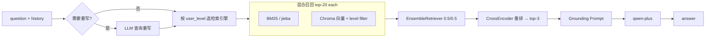

# tiered-rag-service

> 带权限分级的中文文档问答服务：混合检索（BM25 + 向量）→ 交叉编码器重排 → 有据可依的生成。

[](https://github.com/zhni1314/tiered-rag-service/actions)
[](LICENSE)
[]()

**English** — A retrieval-augmented QA service for Chinese PDF corpora. Dense + lexical retrieval are
fused, reranked by a cross-encoder, and compiled into **one retrieval engine per permission tier**,
so a low-privilege caller physically cannot retrieve high-tier chunks. Includes conditional query
rewriting, Redis-backed session history and LLM cache, and SSE streaming.

**这不是「LangChain 官方 RAG 教程跑通了」。** 它解决的问题是：检索链路怎么组合才有效、权限怎么落到
检索层而不是 Prompt 里、以及这套东西怎么变成一个能被别人复现的服务。

---

## 目录

- [为什么这样设计](#为什么这样设计)
- [检索链路](#检索链路)
- [权限分级](#权限分级)
- [快速开始](#快速开始)
- [API](#api)
- [项目结构](#项目结构)
- [测试](#测试)
- [已知限制](#已知限制)
- [Roadmap](#roadmap)

---

## 为什么这样设计

| 设计 | 做法 | 原因 |
|---|---|---|
| 混合检索 | `EnsembleRetriever`：BM25(jieba 分词) 0.5 + bge 向量 0.5，各取 top-20 | 纯向量召回会被专有名词、编号、缩写坑；纯 BM25 召回会被同义表述坑。中文还必须显式分词，`rank-bm25` 默认按空格切，对中文等于按整句切。 |
| 重排 | `bge-reranker-v2-m3` cross-encoder，融合后压到 top-3 | bi-encoder 分别编码 query/doc，交互浅；cross-encoder 拼接编码，精度高但慢，所以只用于对 20 条候选做二次排序，不用于全库。 |
| 查询重写 | **条件触发**：无历史，或问题里没有指代词，直接跳过 | 每次重写多花一次 LLM 调用。中文指代词表命中才走，省掉大部分首轮请求的延迟和费用。 |
| 权限隔离 | 每个权限档位编译一套独立检索引擎 + Chroma metadata filter | 把「不要回答越权内容」写进 Prompt 是请求模型配合；在检索层过滤是让越权内容**根本不进上下文**。 |
| 阻塞计算 | rerank 与向量检索放进 `asyncio.to_thread`；PDF 解析放进 `run_in_threadpool` | sentence-transformers 是同步 CPU 计算，直接在 `async def` 里跑会卡住整个 event loop，并发一上来 P99 就崩。 |
| 缓存 | Redis 同时做会话历史和 LangChain LLM cache | 重复问题不再打模型。 |
| 配置 | 全部环境变量化，`Settings` 为 frozen dataclass | 换机器、进容器不用改代码。测试可以直接注入 env dict，不需要 mock。 |

完整取舍记录见 [docs/decisions.md](docs/decisions.md)。

## 检索链路



## 权限分级

权限档位由 `TIERED_RAG_LEVELS` 定义，**有序**：第 N 档能读 0..N 档。默认 `public,secret`。

每一档在启动和入库时编译成一套独立引擎（各自的 BM25 索引 + 各自的 metadata filter），
`public` 用户的候选集里物理上不存在 `secret` chunk。

```http
POST /chat
{"session_id":"s1","question":"实验 3 的评分标准是什么？","user_level":"secret"}
```

> ⚠️ 目前 `user_level` 由调用方声明，**没有真实鉴权**。这是有意的范围切分，不是疏忽，
> 见[已知限制](#已知限制)。

## 快速开始

### 本地

```bash
git clone https://github.com/zhni1314/tiered-rag-service.git
cd tiered-rag-service

python -m venv .venv && source .venv/bin/activate   # Windows: .venv\Scripts\activate
pip install -r requirements.txt

cp .env.example .env      # 填入 QWEN_API_KEY
docker compose up -d redis

python -m tiered_rag      # API: http://127.0.0.1:8000/docs
python ui/gradio_app.py   # UI : http://127.0.0.1:7860
```

首次启动会下载 `bge-small-zh-v1.5` 和 `bge-reranker-v2-m3`（约 1.2GB）。国内网络把
`.env` 里的 `HF_ENDPOINT` 改成 `https://hf-mirror.com`。

批量入库（不走 HTTP）：

```bash
python scripts/build_index.py --dir data/pdfs --level public
python scripts/build_index.py --dir data/secret_docs --level secret
```

### Docker

```bash
cp .env.example .env && vi .env
docker compose up --build     # api:8000  redis:6379
docker compose --profile ui up
```

## API

| 方法 | 路径 | 说明 |
|---|---|---|
| `GET` | `/healthz` | 存活探针，返回已索引 chunk 数 |
| `POST` | `/upload` | `multipart/form-data`：`file` + `level`，解析入库并重建检索引擎 |
| `POST` | `/chat` | 返回 `answer` / `latency` / `level` |
| `POST` | `/chat/stream` | SSE 流式，打字机输出 |
| `GET` | `/history/{session_id}` | 会话历史 |

```bash
curl -X POST http://127.0.0.1:8000/chat \
  -H 'Content-Type: application/json' \
  -d '{"session_id":"demo","question":"第一章讲了什么？","user_level":"public"}'
```

## 项目结构

```
src/tiered_rag/
├── config.py       # frozen dataclass，所有可调项的唯一来源
├── bootstrap.py    # HF_HOME / HF_ENDPOINT，必须早于模型加载器导入
├── text_cleaning.py# 页眉页脚、中文软换行拼接（纯函数，无依赖）
├── indexer.py      # PDF → 文本 → chunk → Document；上传文件名安全
├── retrieval.py    # BM25 + 向量 + 重排，按权限档编译；带锁重建
├── chain.py        # Runnable DAG：条件重写 → 检索 → 生成
├── history.py      # Redis 会话历史
└── service.py      # FastAPI 装配与路由
ui/gradio_app.py    # 演示前端，只依赖 HTTP
scripts/build_index.py
scripts/evaluate.py   # 缓存收益 + RAGAS 实测，跑在自编语料上，密钥运行时输入
tests/              # 纯逻辑单测，不需要模型/Redis/密钥
```

分层依据是**变更频率**：调检索权重不该碰 HTTP 层，换模型不该碰检索层。
`tests/` 能在 CI 里 0.4 秒跑完，正说明这条边界切对了。

## 测试

```bash
pip install pytest ruff
pytest              # 27 passed
ruff check src tests scripts
```

覆盖：权限档位的有序访问推导、未知档位拒绝、配置默认值、中文软换行拼接、
chunk 尺寸与 metadata 打标、**上传路径穿越拒绝**。

## 已知限制

写在这里而不是藏在代码里，是我对这个项目目前最诚实的评价。

1. **权限没有真实鉴权。** `user_level` 来自请求体，任何调用方都能自称 `secret`。
   现在的实现只证明了「检索层能做数据隔离」，没证明「系统能抵抗越权」。
   最小修复：签发带角色的 Token，服务端解析角色，请求体里的 `user_level` 只作为*请求*，
   以 Token 为准（deny-by-default）。
2. **评测只有小样本流程验证，尚无生产级指标。** `scripts/evaluate.py` 已能实测缓存收益与 RAGAS
   四项指标，但跑在 24 段自编语料、3 道题上：上下文指标已饱和，忠实度的组间差异被评委抖动盖过，
   BM25 与不重排两组消融还没跑。权重 0.5/0.5、`top-3`、`chunk_size=800` 仍是经验值，
   `recall@k` / `MRR` 仍未测量。见 [docs/evaluation.md](docs/evaluation.md)。
3. **每次上传全量重建 BM25**，`O(N)` 且随库增长变慢；小库无所谓，千级 chunk 就需要持久化 BM25。
4. **扫描版 PDF 无输出。** `pypdf` 提不到文字就返回空，需要 OCR。
5. **用了已弃用 API。** `langchain_community.vectorstores.Chroma` 官方建议迁移 `langchain-chroma`。
6. **LLM 缓存不感知权限档。** 缓存键由 Prompt 决定；跨档命中依赖上下文文本完全一致，
   严格说不是隔离泄漏，但值得显式加 level 维度。
7. 上一版响应里的 `cache_hit` 字段是按 `latency < 0.1` 猜的，是伪指标，已删除。

## Roadmap

按「对面试说服力」排序，不是按工作量：

- [ ] 真实鉴权：角色化 Token + deny-by-default（补限制 1）
- [ ] 评测集扩到 30+ 题（含干扰文档），补 BM25 与不重排两组消融，测 `recall@k` / `MRR`（补限制 2）
- [ ] 引用溯源：答案回链到 chunk 与页码
- [ ] 迁移 `langchain-chroma`，去掉弃用告警
- [ ] BM25 索引持久化，避免全量重建
- [ ] 大文件入库改后台任务队列
- [ ] 结构化日志 + `/metrics`（Prometheus）
- [ ] 把检索器包成 tool，交给 agent 决定何时检索（从 RAG 迈向 Agent）

## 技术栈

`Python 3.11+` · `LangChain 1.4` · `FastAPI 0.162` · `Chroma 1.5` · `sentence-transformers 6.2` ·
`bge-small-zh-v1.5` + `bge-reranker-v2-m3` · `Redis` · `Gradio 6.30` · `Docker Compose`

LangChain 1.x 的检索组件已迁到 `langchain-classic`，本项目按新命名空间接入。

## License

MIT
