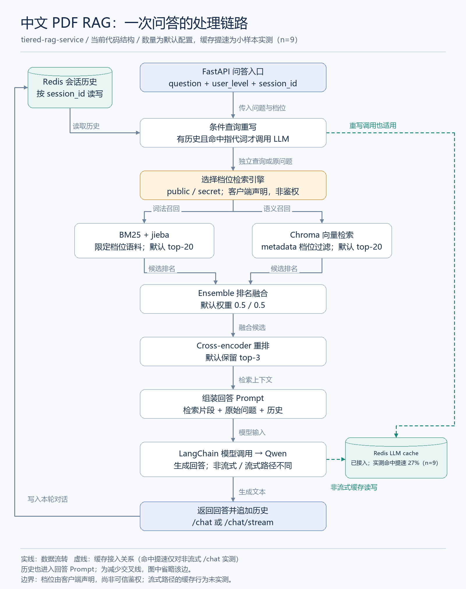

# 从能回答到可验证：我的中文 PDF RAG 工程化实践

> 说明：本文的缓存与 RAGAS 数据是**真实测出来的**，但样本很小（缓存 9 组、质量 3 题），语料是**自编的虚构团队手册**，不是学院资料。所以这些数字用来说明「怎么测、测出了什么意外」，不能当作生产问答质量的结论。
>
> 掘金排版：正文使用 Markdown。架构图需上传下方 PNG 后替换本地图片链接；建议标签为「人工智能」「Python」「后端」。

把 PDF 切块、放进向量数据库，再接一个大模型，就能搭出文档问答的基本链路。

但围绕这条链路继续开发时，会遇到另一组问题：编号类问题怎么检索？多轮追问要不要重写？不同档位的文档怎么过滤？改了清洗逻辑，如何知道有没有破坏原来的行为？接上 Redis，又该怎样证明缓存真的有效？

我是大二学生，正在准备 AI 应用开发方向的实习。这篇文章记录我在 `tiered-rag-service` 中的工程化尝试：不把组件列表当成果，而是说明每个选择解决什么问题，以及哪些结论还缺实验支持。

项目地址：[zhni1314/tiered-rag-service](https://github.com/zhni1314/tiered-rag-service)。

## 一、项目做什么，以及暂时不做什么

这是一个面向中文 PDF 的分级检索问答服务：FastAPI 提供上传和问答接口，LangChain 编排链路，Chroma 保存向量，BM25 与向量检索融合后再重排，Qwen 负责生成回答。Redis 保存会话历史并承接 LLM 缓存，Gradio 提供交互入口。

定位是**工程化学习项目**，不是已经上线的企业级知识库，也不是具有规划、工具调用循环的 Agent 系统。

当前实现的是档位过滤：`public` 检索公开文档，`secret` 检索公开和秘密档位文档。档位仍由客户端传入，因此它**不是身份认证，也不是物理存储隔离**。

## 二、先看一次问答如何流转



图中是代码结构，不是实测时序；节点中的数量是默认配置。虚线表示缓存接入关系，不代表已经观测到命中。历史还会进入回答 Prompt，为了避免交叉线，没有单独画出这条边。

上传链路相对独立：PDF → pypdf 提取文本 → 清洗 → 切块 → 写入 Chroma → 更新检索器池。当前没有 OCR，扫描件不能仅靠这条链路完成识别。

### 1. 为什么同时保留 BM25 和向量检索？

中文文档问题不只有语义匹配，也可能包含精确术语、编号和缩写。BM25 提供词法匹配，向量检索提供语义相似度，两者的设计目标是互补，但是否优于单路检索，还需要评测。

当前默认配置如下，不代表经过系统调参得到的最优值：

| 环节 | 默认配置 |
| --- | --- |
| 切块 | chunk_size=800，chunk_overlap=20 |
| Embedding | BAAI/bge-small-zh-v1.5 |
| 词法召回 | BM25 + jieba，top-20 |
| 向量召回 | Chroma，top-20 |
| 排名融合 | EnsembleRetriever，权重 0.5 / 0.5 |
| 重排 | BAAI/bge-reranker-v2-m3，保留 top-3 |
| 生成模型 | qwen-plus |

这里融合的是两路候选排名，不能把 BM25 原始分数与向量相似度直接当成同一量纲相加。两路各取 20 条，融合去重后的候选最多约 40 条，**不是固定拿 20 条做重排**。

重排模型对查询和候选文档进行联合评分，再把排名靠前的片段交给生成模型。它增加了计算开销；只有在答案或检索指标上的收益足够时，这个开销才值得。第五节会看到，本次 CPU 环境下重排让检索耗时放大了约 220 倍。

### 2. 档位过滤必须覆盖两条召回分支

只过滤 Chroma 不够，因为 BM25 也可能把不允许的文档召回。

当前做法是为每个档位构建对应的 BM25 语料，并给向量检索设置 metadata filter。核心代码为：

```python
bm25 = BM25Retriever.from_documents(
    docs, preprocess_func=jieba.lcut, k=settings.retrieve_k
)
vector = vectorstore.as_retriever(
    search_kwargs={
        "k": settings.retrieve_k,
        "filter": {"level": {"$in": allowed}},
    }
)
```

这里 `docs` 已按允许档位筛选。两处过滤分别约束不同的召回入口，不是同一批候选上的两次安全校验。

这仍然不能支撑“不会越权”的承诺：服务端还没有可信身份来源，会话历史也没有按用户和档位隔离。检索过滤只是完整访问控制中的一部分。

### 3. 多轮问题不一定每次都要重写

例如，先问“什么是向量检索”，再问“它有什么局限”，第二个问题需要历史才能确定“它”指什么。

当前采用一个简单启发式：没有历史，或者问题中没有命中配置中的指代词，就跳过重写；否则调用 LLM 生成独立查询。

```python
if not history.strip() or not any(p in question for p in _PRONOUNS):
    return question
return rewrite_chain.invoke({"question": question, "history": history})
```

跳过这条分支会少执行一次重写模型调用，但端到端能快多少，不能凭调用次数直接推算。规则也会误判：不含指代词的省略问句可能仍依赖历史，包含“这”“那”的问题也未必需要重写。

## 三、工程化不是把一个文件拆成十个文件

我的拆分依据是“什么东西会因为同一种需求而改变”，而不是追求目录复杂。

| 模块 | 变化主要落在哪里 |
| --- | --- |
| config | 模型、路径、检索参数、档位配置 |
| text_cleaning / indexer | 文本清洗、PDF 提取、切块、文件名处理 |
| retrieval | 双路召回、档位过滤、融合、重排 |
| chain | 查询重写、上下文组装、回答 Prompt |
| history | 会话读写和历史窗口 |
| service | 生命周期装配、HTTP 参数校验与接口 |

比如，调整召回数量可以改配置；修改重排算法仍需要改代码。配置外置不是把所有需求都变成“改一个环境变量”，而是把常变参数与业务逻辑分开。

另一个收益是测试边界更清楚。本次本地运行现有测试，结果为 **45 项通过**（另有若干来自依赖的弃用警告）。覆盖范围是配置、文本清洗、文件路径、切块逻辑，以及评测脚本自身的缓存计数与打分流程，不需要启动 Redis 或调用大模型。

这证明的是这些具体断言通过了，**不是整个系统没有问题，更不是问答质量达到某个分数**。仓库 CI 也主要运行静态检查和这批单元测试，不包含真实模型评测。

同步检索和重排通过 `asyncio.to_thread` 移出事件循环，避免在该位置直接阻塞其他异步任务。但线程化不等于吞吐量必然提高：CPU/GPU 资源竞争、并发控制和排队仍需要压测。

## 四、Redis 接上了，缓存收益怎么测？

### 1. 先区分会话历史和模型缓存

项目使用同一个 Redis 客户端承担两类职责：

- **会话历史**：按 session_id 保存消息，帮助理解后续追问。
- **LLM cache**：复用相同模型输入对应的生成结果。

当前缓存接入代码是：

```python
redis = Redis.from_url(settings.redis_url, protocol=2, decode_responses=True)
set_llm_cache(RedisCache(redis))
```

核对本地 `langchain-core==1.6.10` 和 `langchain-community==0.4.2` 的实现，非流式模型缓存依据序列化后的消息与模型调用标识查找结果。它不是只用用户问题作为 key 的整条问答结果缓存。

因此，即使问题一样，也可能不命中：历史变化、检索片段变化或模型参数变化，都可能改变缓存输入。即使生成阶段命中，前面的检索与重排通常仍然执行。

忽略条件重写时，可以把耗时粗略拆为：

```text
未命中：历史读取 + 检索 + 重排 + Prompt 组装 + 缓存查找 + 模型生成 + 缓存写入 + 历史写入
命中：  历史读取 + 检索 + 重排 + Prompt 组装 + 缓存查找与反序列化 + 历史写入
```

收益主要来自避免这次外部生成请求，不意味着整条链路变成一次 Redis 查询。

### 2. 为什么不能在聊天框连续问两次就下结论？

第一次问答结束后，服务会把本轮内容写入历史。第二次即使输入同一个问题，最终 Prompt 也可能不同，所以这不是严格控制变量的缓存实验。

另一个容易忽略的点是流式接口。本地版本的 `BaseChatModel.astream` 正常流式分支直接进入流式生成，不经过非流式的 `_agenerate_with_cache`；回退到 `ainvoke` 时则是另一条路径。当前 Gradio 调用的是 `/chat/stream`，其中条件重写仍可能走非流式模型调用。

所以，不能把 `/chat` 的缓存测试结果直接写成“前端流式回答提速了多少”。下一节的实测走的就是**非流式**路径，流式接口的缓存行为仍然没有验证。

### 3. 缓存前后数据：实测结果

实际做法：固定同一份自编语料索引、同一档位、空历史、非流式 `build_chain`，每组前先用一次不计入统计的调用完成模型预热并预填缓存，再跑 `关闭缓存 / 启用但未命中 / 确认命中` 三组，顺序随机打乱。命中与否由缓存查找结果和真实 HTTP 请求计数判定，不用“低于 0.1 秒”猜。

环境：Windows 11 + CPU 推理，qwen-plus，并发 1，3 道题 × 3 轮 = 每组 9 个有效样本，共 28 次请求（6,257 prompt + 552 completion tokens）。

| 组别 | 有效样本 | 总耗时 P50 | 总耗时 P95 | 其中检索+重排 P50 | 外部模型请求 | 实测命中率 |
| --- | --- | --- | --- | --- | --- | --- |
| 关闭 LLM 缓存 | 9 | 4623 ms | 5215 ms | 3642 ms | 9 | 不适用 |
| 启用缓存、目标键不存在 | 9 | 4459 ms | 4721 ms | 3545 ms | 9 | 0 |
| 预填充缓存、复用相同输入 | 9 | 3369 ms | 3661 ms | **3361 ms** | **0** | 1 |

三个结论，其中第一个和预期不一样：

1. **命中缓存只快了 27.1%**（4623 → 3369 ms）。因为命中后剩下的 3369 ms 里，有 3361 ms 是检索和重排——**占 99.8%**。缓存省掉的只是生成那一段，整条链路根本没有变成“一次 Redis 查询”。
2. **启用缓存但未命中，和完全不开缓存没有可测出的差别**（4459 vs 4623 ms，9 个样本不足以区分这点差异）。Redis 查找本身的中位耗时只有 0.90 ms，最大 2.62 ms，所以开缓存的固定成本可以忽略。
3. **缓存会把某一次的输出“冻结”。** 同一道题在三次独立预热里生成了不同措辞的回答（3 次里出现 2 种、3 种结果），说明 `temperature=0` 也不保证服务端输出一致。命中时返回的是当初那段文本，重复提问不再得到新答案——这在需要“再答一次”的场景里是代价，不是收益。

P50 是中位数，P95 在 9 个样本下只表示数量级，不能当稳定分位数引用。要写成“生产收益百分比”，还需要更大样本、真实流量命中率和多并发下的重测。

## 五、RAGAS：把“看起来回答不错”拆成可检查的问题

### 1. 不是只填一个“RAGAS 总分”

RAGAS 提供不同维度的指标，不能把其中一个值直接叫作系统准确率。本文使用以下指标（`ragas==0.4.3`，评委模型 `qwen-plus`，评委用的嵌入模型和被测系统同一个本地 bge-small-zh）：

| 指标 | 主要检查什么 | 所需数据 |
| --- | --- | --- |
| Faithfulness | 回答中的陈述是否被检索上下文支持 | 问题、回答、检索上下文 |
| AnswerRelevancy | 回答是否切合问题，不等于事实正确率 | 问题、回答；评估过程需要 LLM 和 embeddings |
| ContextPrecisionWithReference | 有用上下文是否排在前面 | 问题、参考答案、检索上下文 |
| ContextRecall | 参考答案中的信息是否被检索上下文覆盖 | 问题、参考答案、检索上下文 |

LLM 判分也会出错。即便忠实度高，也只说明回答较符合提供的上下文，不能证明原始文档内容正确，更不能验证权限安全。这里还有一个我自己没避开的偏差：**评委和被测系统是同一个模型系列**，存在自我偏好风险，正式结论应换一个评委模型再跑一遍。

### 2. 评测输入必须来自同一次问答

当前 `/chat` 只返回答案、延迟和档位，没有返回检索上下文。所以评测脚本绕开 HTTP，直接调用 `build_chain`，并在检索器外面包一层记录器，抓下**这一次真正交给模型的重排后片段**，再连同问题、回答、参考答案一起送去打分。不能事后另检索一次，把不同的片段拿来给原答案打分。

评测样本长这样（自编语料，参考答案依据手写文本人工确定，不是模型自己生成的）：

```json
{
  "user_input": "青禾研发团队项目例会的时间、地点和时长是什么？",
  "response": "每周三下午三点，在松林会议室召开，时长四十五分钟。",
  "retrieved_contexts": ["青禾研发团队每周三下午三点召开项目例会，地点为松林会议室，时长四十五分钟。……"],
  "reference": "每周三下午三点，在松林会议室召开，时长四十五分钟。"
}
```

正式数据应来自允许公开或已授权的文档。使用外部评测模型还涉及文本外发和费用，不能默认把私有 PDF 送出去——这也是本次评测另建一份自编语料、而不是直接测学院资料的原因。

计划先用 30 条人工审核样本打通流程，再扩展到约 100 条；覆盖精确术语、同义改写和跨段信息。库外拒答、多轮追问、档位边界单独报告，不能把不适用的指标硬凑进同一个均值。

### 3. RAGAS 分数：实测结果与它暴露的问题

固定同一份语料索引、同一问题集、同一生成模型和 Prompt，关闭生成缓存，只换检索方案。先跑了最容易对比的两组（每组 3 题，全部成功，无失败或跳过得分）：

| 方案 | 忠实度 | 答案相关性 | 上下文精确率 | 上下文召回率 | 检索 P50 | 单次总耗时 P50 |
| --- | --- | --- | --- | --- | --- | --- |
| 纯向量，取 top-3 | 0.833 | 0.961 | 1.000 | 1.000 | 15 ms | 845 ms |
| 混合检索 + 重排，取 top-3 | 1.000 | 0.964 | 1.000 | 1.000 | 3306 ms | 3964 ms |

这次花了 60 次请求（54,968 prompt + 3,922 completion tokens），其中**只有 6 次是生成，54 次是评委打分**——LLM-as-judge 的成本远高于被测系统本身。

看着像“重排让忠实度从 0.833 提升到 1.0”，但拆开记录后站不住：

1. **这 3 道题没有区分度。** 两种方案的标注文档召回率都是 1.0，上下文精确率和召回率都满分——纯向量本来就把正确段落捞上来了，重排无从体现价值。
2. **忠实度那 0.167 的差距来自评委抖动。** 第 1 题两组给出的回答**文字完全相同**（“需要直属负责人和部门负责人审批”），评委却分别给了 0.5 和 1.0。既然同一个输入能得到不同分，n=3 时任何小数位差异都不构成结论。
3. **重排的代价是确定的。** 检索耗时从 15 ms 涨到 3306 ms，约 220 倍；在这 3 题上没换来任何可辨的质量优势。

所以这一轮真正得到的不是“混合检索更好”，而是：**评测集太简单、样本太小，测不出差异；同时暴露了评委不稳定和重排开销这两个必须处理的问题。** 接下来要扩到 30 题以上、加入会混淆的邻近文档（比如另一个团队的同类规则），并对同一份回答重复打分取分布，而不是只跑一次。

脚本还支持另外两组消融（`--variants bm25 hybrid`），但**这两组我还没跑**，不预先写结论。另外要说明：权重设成 0 不等于对应检索分支停止执行，`rerank_top_n=0` 也不是当前实现里合法的“关掉重排”方式，所以单路实验必须真的只走那一路，脚本里是直接取对应检索器来保证这一点。

## 六、当前最需要补上的边界

- **评测本身还很弱**：目前只有 3 题 × 2 方案的自编语料，指标已饱和、评委不稳定，且评委与生成模型同源；学院资料没有参与评测。
- **可信身份与历史隔离**：档位来自客户端；历史只按 session_id 索引，UI 还使用固定会话 ID，不能按多用户安全服务宣传。
- **证据溯源**：切块元数据尚未保存完整的文件、页码和稳定 chunk ID，精确引用及评测标注仍不完善。
- **入库并发**：上传会全量重建 BM25；快照替换减少半成品暴露，但不能据此宣称已经解决并发入库一致性。
- **缓存生命周期**：当前没有显式配置 LLM 缓存 TTL，也没有完整的权限变更、语料更新失效策略。
- **交付验证**：单元测试不覆盖真实问答和 UI；Docker 配置存在不等于已验证容器部署。

这些限制不是写在文末就算解决了，而是决定这个项目目前适合在哪里使用、还不能承诺什么。

## 结语

这次项目整理让我更明确地区分了三件事：**组件接入了，功能是否按预期工作，以及收益是否被实验验证。**

把缓存和 RAGAS 真的跑一遍之后，得到的结论比预想的“扫兴”：缓存命中只降 27% 延迟，因为瓶颈是重排而不是模型调用；评测集太简单，两种检索方案打平，唯一那点分差还来自评委自身的抖动。这些不比“准确率提升了多少”更难看——它们是我下一步该改什么的依据：先解决重排开销和评测集区分度，再谈混合检索的收益。

代码和评测脚本都在仓库里，数据文件在 `data/evaluation/<运行ID>/`（不入库）。如果你也在做类似的项目，建议先把“怎么证明有效”写成能跑的脚本，再决定要不要加下一个组件。

---

### 源码对照

以下链接固定在本文核对的代码版本，便于对照实现，而不是只看描述：

- [服务装配、Redis 接入与问答接口](https://github.com/zhni1314/tiered-rag-service/blob/d1aee60/src/tiered_rag/service.py#L41)
- [条件重写与回答链路](https://github.com/zhni1314/tiered-rag-service/blob/d1aee60/src/tiered_rag/chain.py#L36)
- [混合检索与档位引擎](https://github.com/zhni1314/tiered-rag-service/blob/d1aee60/src/tiered_rag/retrieval.py#L21)
- [默认模型与检索参数](https://github.com/zhni1314/tiered-rag-service/blob/d1aee60/src/tiered_rag/config.py#L95)
- [会话历史存储](https://github.com/zhni1314/tiered-rag-service/blob/d1aee60/src/tiered_rag/history.py#L16)

<!-- 配图依据 architecture-communicator 技能核对；juejin-architecture.mmd 为源，PNG 为发布导出。 -->
